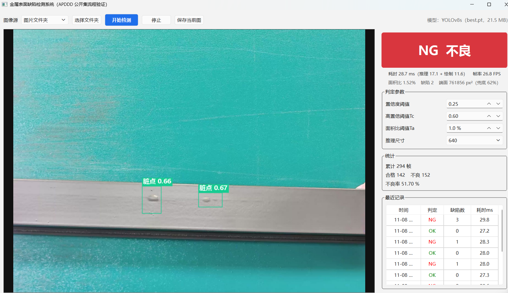

# 金属表面缺陷检测系统（YOLOv8 + PySide6）

一个能在 Windows 上直接双击运行的桌面缺陷检测程序：读摄像头 / 手机视频流 / 图片文件夹，用 YOLOv8 检测工件表面缺陷，按业务阈值给出 OK / NG，并把每帧结果写进 SQLite、把不良图存盘。

- 数据：金属表面缺陷公开数据集 APDDD（ModelScope 可下载，1885 张、10 类缺陷）
- 模型：YOLOv8s（同条件：同数据、同超参、50 epoch，与 YOLOv8n 对比后选用）
- 环境：Windows + Python 3.11 + PyTorch 2.5.1(cu121) + Ultralytics 8.4.203 + PySide6 6.12
- 说明：本仓库是**公开数据集上的流程验证**，不是产线交付系统；相机分支未在真机上验证。

> 仓库只保留程序、训练/评估/验证脚本、结果与截图；`datasets/`、`runs/`、`weights/` 为本地生成，不随仓库提交。权重（`best.pt`=s、`best_v8n.pt`=n）见 Releases（sha256:656ce0b49aaab282d49e2b247415a906673c57e443cce8a798484213d4aae461、sha256:25344b3b1e5e870720a03722801f0409b2d497c0a668a22fd9700a2ba1d10e76）。

## 结果速览



| 模型 | 测试集 mAP50 | mAP50-95 | P | R | 部署点 P/R（conf=0.25） | 单帧 predict |
|---|---|---|---|---|---|---|
| YOLOv8n | 0.516 | 0.280 | 0.669 | 0.480 | 0.673 / 0.434 | 7.5 ms |
| YOLOv8s | 0.549 | 0.289 | 0.560 | 0.558 | 0.569 / 0.469 | 8.2 ms |

- 界面端到端 **28.7 ms**（推理 17.1 + 绘制 11.6），**26.8 FPS**；连续无显示时推理 8.0 ms、端到端 19.4 ms。
- badcase（189 张、conf 0.25、IoU 0.5）：TP 149 / FP 113 / FN 169，完全正确 74 张（39.2%）；明细见 `docs/results/badcase.csv`。
- 指标原始文件、训练曲线数据与对比图在 `docs/results/` 与 `docs/screenshots/`。

> 边界：公开集没有正常件（只能测漏检、测不了过杀）、划分有 11 张测试图与训练图重复、Ta/Tc 未标定、相机分支未真机验证。详见第 7 节，答辩/简历请按这些边界讲。

## 1. 目录结构

| 路径 | 是什么 |
|---|---|
| `app/` | 正式程序：`main.py` 入口，`ui_main.py` 界面，`detector.py` 推理，`judge.py` 判定，`camera.py` 取流，`db.py` 落盘，`config.py` 配置 |
| `run_app.bat` | Windows 启动脚本（先在 Anaconda Prompt 里 `conda activate bearing`） |
| `docs/` | 截图、指标 JSON、`results.csv`、`badcase.csv`（面试官会看的部分） |
| `samples/` | 4 张示例图，不下载完整数据集也能跑演示 |
| `weights/` | 本地权重（`best.pt`=s、`best_v8n.pt`=n），不提交；见 Releases |
| `runs/detect/apdd_n`、`apdd_s` | 本地训练产物（`results.csv`、曲线、`metrics_summary.json`），不提交 |
| `datasets/apdd/` | 本地数据集（images/labels + `data.yaml`），不提交 |
| `验证_*.py` | 8 个自查脚本：权重、指标、判定、耗时、badcase、ONNX、安全、冒烟 |
| `_*.py` | 数据转换、两次训练、评估、n-s 对比脚本（复现用） |

## 2. 装环境（新电脑从零开始）

```bat
conda create -n bearing python=3.11 -y
conda activate bearing
python -m pip install -r requirements.txt
```

装完先验显卡版装对了没有（必须打印 `True`，打印 `False` 就是装成了 CPU 版，GPU 速度复现不出来）：

```bat
python -c "import torch;print(torch.cuda.is_available())"
```

再跑一次真实推理：

```bat
python check_env.py
```

显卡不是 N 卡也能跑，只是走 CPU，单帧会到几百毫秒；`torch` 需要装 CUDA 版才能用 GPU。

## 3. 跑起来

先在 **Anaconda Prompt** 里激活环境，再双击 `run_app.bat`；或命令行：

```bat
conda activate bearing
python app\main.py
```

界面用法：
1. 「图像源」选 `图片文件夹`（无摄像头时最稳），点「选择文件夹」选 `datasets\apdd\images\test`；**没有完整数据集时，选仓库里的 `samples` 也能跑**；
2. 点「开始检测」，右侧出现 NG/OK、耗时、面积比、缺陷数；
3. 点「保存当前图」存下当前标注图；
4. 下方「最近记录」是 SQLite 里真实写入的记录。

正常表现（RTX 3060 Laptop）：**耗时约 22–29 ms（推理 8–17 + 绘制 12–16），帧率约 27 FPS（文件夹模式不限速）**，端面显示「761856 px²（兜底 62%）」。连续无显示时推理 8 ms、端到端 19.4 ms（见 `验证_4_耗时.py`）。

> 注意：显卡在空闲约 0.1–0.2 秒后会降频；实测**人为等到 0.2 秒时推理掉到 68 ms**。所以文件夹模式**不限速（sleep=0）**，不要为了“稳”去加 sleep——加了反而更慢（0.1 s → 70 ms，0.02 s → 30 ms）。

## 4. 训练 / 评估

训练（两条命令对应 n 与 s，超参在 `_train_apdd.py` / `_train_apdd_s.py` 里）：

```bat
python _train_apdd.py
python _train_apdd_s.py
```

评估并写 `metrics_summary.json`（**参数决定评哪个模型，默认是 `apdd_n`，评主模型必须显式传 `apdd_s`**）：

```bat
python _eval_run.py apdd_s
python _eval_run.py apdd_n
```

指标现状（测试集 189 张）：

| 模型 | mAP50 | mAP50-95 | P | R |
|---|---|---|---|---|
| YOLOv8n | 0.516 | 0.280 | 0.669 | 0.480 |
| YOLOv8s | 0.549 | 0.289 | 0.560 | 0.558 |

- 这组 P/R 是「最佳 F1 置信度」下的整体指标；
- **部署阈值 conf=0.25 下**重算是 n：P 0.673 / R 0.434、s：P 0.569 / R 0.469（跑 `验证_2_指标.py` 得到）；

**best.pt 是哪一轮**：ultralytics 8.4.203 的 `fitness` 权重是 `[0, 0, 0, 1]`，只按 mAP50-95 存 best。
- n：mAP50 最高在第 35 轮（0.58649），但第 30 轮 mAP50-95 更高（0.33489 vs 0.33237），所以 `best_v8n.pt` 是第 30 轮；
- s：mAP50 最高在第 48 轮（0.62861），但第 46 轮 mAP50-95 更高（0.36027 vs 0.35027），所以 `best.pt` 是第 46 轮（权重里记录的 fitness = 0.36027）。


数据集重建（需要先下原始数据）：

```bat
python _build_apdd_yolo.py
```

`data.yaml` 里的 `path` 是**绝对路径**，换电脑必须改。

ONNX 导出（已验证，但主程序仍走 PyTorch）：

```bat
python 验证_6_ONNX.py
```

产出 `weights/best.onnx`（42.7 MB，opset 12，1×3×640×640 → 1×14×8400）；与 PyTorch 原始输出对拍：最大差 0.0041、均值 1.5e-5、置信度>0.25 的候选框数量一致（10 vs 10），属 float32 在 GPU 与 CPU 上的正常漂移。

## 5. 判定逻辑

1. 置信度 0.25 只做过滤，不参与判定；
2. 端面面积：霍夫圆拟合（缩到长边 360 再找圆），拟合失败按图像面积 62% 兜底；
3. NG 条件为「或」：缺陷框面积和 / 端面面积 ≥ Ta（默认 1.0%），或任一框置信度 ≥ Tc（默认 0.60）；
4. 结果写 SQLite，NG 帧另存标注图。

## 6. 自查脚本

| 脚本 | 查什么 | 耗时 |
|---|---|---|
| `check_env.py` | Python / torch / CUDA / 用本项目权重跑通一次推理 | 20 秒 |
| `验证_1_权重.py` | 默认权重是不是 s、类别对不对、COCO 权重会不会被拦住 | 20 秒 |
| `验证_2_指标.py` | 指标真假 + 部署点 P/R 重算 | 30 秒 |
| `验证_3_判定与数据.py` | 划分数量、框数、空标注、跨划分重复、判定触发 | 1 分钟 |
| `验证_4_耗时.py` | 推理与绘制分阶段计时、空闲降频现象 | 1 分钟 |
| `验证_5_BadCase.py` | 逐图 TP/FP/FN、导出 bad case 清单与前 12 张图 | 1 分钟 |
| `验证_6_ONNX.py` | ONNX 导出与 ORT 推理对拍（同一张图比原始输出） | 2 分钟 |
| `验证_7_安全检查.py` | 手机号 / 邮箱 / 密钥 / 绝对路径 / 大文件残留 | 5 秒 |
| `验证_8_冒烟训练.py` | 120 张、1 epoch、seed 0，证明训练链路能跑 | 1 分钟 |

## 7. 明确的限制

1. 测试集**没有正常件**（三个划分空标注都是 0），只能测漏检，测不了过杀；
2. 划分有字节级重复：test∩train 11 张、test∩val 2 张、val∩train 16 张，指标偏乐观；
3. 公开集是铝型材表面缺陷，不是轴承端面；轴承数据自采部分尚未开始；
4. 摄像头 / 手机视频流分支未真机验证（本机无摄像头）；
5. 未做：量化、TensorRT、工业相机 SDK、误检归因与增量训练；ONNX 只做了离线对拍，尚未接进主程序。

## 8. Bad case 现状（可复现）

189 张测试图、conf 0.25、IoU 0.5 同类别匹配：TP 149 / FP 113 / FN 169 → P 0.569 / R 0.469，**完全判对的图只有 74 张（39.2%）**。

- 漏检最多：`zangdian` 40、`qikeng` 36、`budaodian` 34、`cahua` 30；
- 误检最多：`cahua` 36、`budaodian` 26、`zangdian` 15；
- 最差单图：`img3260.jpg` 人工标 10 个只检出 3 个；`img1142.jpg`、`img1168.jpg` 3 个 `qikeng` 全部漏掉。

明细在 `runs/badcase/badcase.csv`，可视化是 `runs/badcase/worst_*.jpg`（绿框=人工标注，红框=模型预测）。
